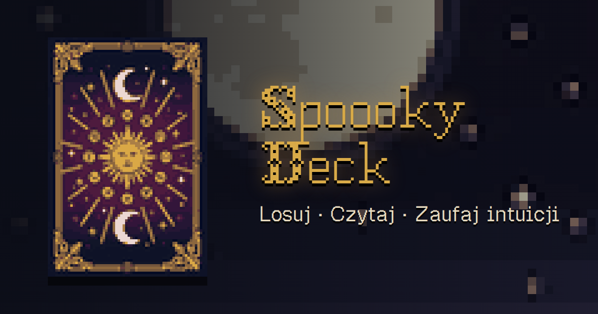

# Spoooky Deck



A dark tarot oracle for companies. You enter a name, a zodiac sign, a company and its industry and stage, pick a card from a fan of 78, and the reading always ends with the conclusion that the company needs a designer. At the end there is a link to the [whosz.pl](https://whosz.pl/offer/) offer.

Live: https://whosz.pl/tarot/

**Status:** complete and deployed (24 Oct 2026), refined since. The process is described in [docs/case-study.md](docs/case-study.md).

## What it is

- Plain static files (HTML, CSS, ES modules), no backend and no build step.
- A PWA: installable on the home screen, works offline (service worker, network first).
- Two languages from the start: Polish and English.
- 78 cards (22 major and 56 minor arcana) in a 16-colour retro pixel style, a 64×96 grid scaled by a whole number of device pixels.
- Form: name, zodiac sign, company, plus its industry and stage (and a "Clear form" button). Industry and stage add a paragraph tailored to the company.
- Readings are composed by a [Tracery](https://github.com/galaxykate/tracery) grammar with [seedrandom](https://github.com/davidbau/seedrandom) randomness. The card, position (upright or reversed), zodiac sign, industry, stage and service decide the text, and the punchline always points to a designer. Minor arcana get an extra sentence about whether the sign's element matches the suit.
- The reading screen has three tabs: **Reading**, **Card** (meaning and keywords) and **Key** (how the arcana, sign, element and position affect the reading).
- Menu (hamburger): language, sound, app installation, a "Licenses" button (it leads to the licences section of this README) and creator info.
- A fan of cards with shuffling, inertia and picking by finger or mouse, a card reveal with sparks, gold shine, and tilt following the cursor, the gyroscope or dragging.
- Sound: a music loop (paused when the app is in the background and cached for offline use) and effects generated in the browser ([ZzFX](https://github.com/KilledByAPixel/ZzFX)).
- Sharing: a link carrying only the draw seed (no name or company) with one inviting sentence and the card name, and a reading image to save or share. The link has a preview in messengers (Open Graph).
- Updates without clearing the cache: modules and data have a version in their URL (`?v=N`), and the app checks for a new version when you return to it and reloads when nothing is lost.
- Privacy: name, company, industry and stage stay on the device. Nothing is sent to a server or stored in the link.

## Structure

```
index.html, manifest.webmanifest, sw.js (generated), favicon.ico, .htaccess
css/      style, cards, theme, fonts
js/       app, deck, oracle, fx, audio, share (+ vendor: tracery, seedrandom, zzfx)
data/     cards.json, grammar.{pl,en}.json, zodiac.{pl,en}.json, ui.{pl,en}.json
img/      cards/ (78 PNG), ui/, emoji/, icons/, og.png
fonts/    woff2/ttf (OFL); Olde Tome is on the server only (see below)
audio/    spoooky-theme-mm.mp3
schema/   JSON schemas of cards, grammar and zodiac
tools/    generators, validators and scripts (deploy, service worker, graphics)
docs/     case study, licensing notes, previews
```

See [ARCHITECTURE.md](ARCHITECTURE.md) for the module contracts, [BRIEF.md](BRIEF.md) for the product brief and [STYLE.md](STYLE.md) for the palette and fonts.

## Running locally

```bash
python3 -m http.server 8123
# http://localhost:8123/
```

Preview a specific card: `?card=ar13` (major arcana `ar00`-`ar21`; minor `wa`, `cu`, `sw`, `pe` + `01`-`14`), reversed: `&rev=1`. Language: `?lang=en`.

## Tests and tools

```bash
node tools/test_oracle.mjs         # every card x position x sign x industry x stage x language (7488 readings)
python3 tools/validate_cards.py    # schema and forbidden characters in cards.json
python3 tools/build_sw.py          # generates sw.js (file list + a version from a hash)
node tools/smoke.cjs [url]         # smoke test and regressions: the whole flow in PL and EN, phones 390 and 320 px (needs Playwright)
node tools/update_test.cjs         # an update without clearing the cache, also from an old version (needs Playwright)
python3 tools/bump_version.py      # bumps the ?v=N version before a deploy (deploy.sh does it too)
```

The deck, the backgrounds and the music are AI-generated (noted in the licences section below). The cards were made with an image model (Replicate, Flux 2 Pro) and processed with the scripts in `tools/ai/` (downscaled to 64×96, 16-colour palette). The raw images are not in the repository.

## Deployment

`tools/deploy.sh` uploads the files to the server over SFTP. Credentials are kept in a local file outside the repository. Apache, directory `whosz.pl/tarot/`, relative paths. `.htaccess` sets MIME types and cache headers.

## Authors and licences

Author: Mateusz Staniszewski, [whosz.pl](https://whosz.pl), 2026. Licence details of the dependencies, fonts and emoji: [licenses.txt](licenses.txt). Terms for commercial use and a checklist: [docs/licensing.md](docs/licensing.md).

- **AI-generated content.** The music (`audio/spoooky-theme-mm.mp3`) was generated with MiniMax Music 2.6 (via Replicate) and the card art and backgrounds with Flux 2 Pro (via Replicate). MiniMax requires AI-generated content to be labelled; this notice is that label (the app menu only links to this section). The commercial terms for MiniMax outputs are less clear than ACE-Step's (MIT), see [docs/licensing.md](docs/licensing.md). Scripts: `tools/ai/music2.py` (MiniMax), `tools/ai/music.py` (ACE-Step).
- Title font: Old English Gothic Pixel (OFL, included in `fonts/`). The Olde Tome font (headings) is not included in the repository; without it the headings fall back to another font.
- Pixel emoji: SerenityOS (BSD-2). The reading texts were checked with the humanizer skills (`.claude/skills/`).
