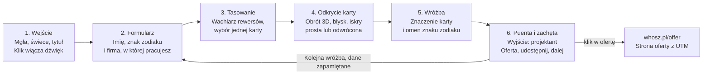

# Plan aplikacji: Spooooky Deck

23 października 2026 · Mateusz Staniszewski

## Cel i koncepcja

Aplikacja to mroczna, pikselowa wyrocznia dla firm. Użytkownik wpisuje swoje imię, znak zodiaku i nazwę firmy, w której pracuje, losuje jedną kartę z pełnej talii 78 kart, a wróżba o przyszłości tej firmy zawsze kończy się wnioskiem, że firmie przyda się projektant. Ostatni ekran prowadzi do [oferty whosz.pl](https://whosz.pl/offer/) i proponuje kolejne losowanie.

- **Dla kogo:** osoby pracujące w małych firmach i startupach (od pracowników po właścicieli), czyli ta sama grupa, do której kierowana jest oferta whosz.pl (identyfikacja wizualna, UX/UI, strony www, pakiet dla startupów).
- **Po co:** zabawny, udostępnialny „lead magnet”. Ludzie wrócą po kolejną wróżbę, podzielą się wynikiem, a część kliknie w ofertę.
- **Język:** polski na start, z przygotowaniem pod angielski (oferta whosz.pl też jest w obu językach).
- **Ton wróżby:** tajemniczy i trochę złowieszczy jak w grze, ale życzliwy na końcu. Karta wskazuje problem, puenta wskazuje rozwiązanie: projekt.
- **Zasada techniczna:** czyste pliki statyczne (HTML, CSS, JS, obrazy, dźwięki) wrzucane na twój serwer www. Bez backendu i bez frameworka z procesem budowania.

## Przepływ użytkownika



Sześć ekranów prowadzi od formularza do oferty. Po wróżbie użytkownik może przejść do oferty albo losować dalej. Dane z formularza zostają zapamiętane, więc kolejna wróżba to dwa kliknięcia. Link udostępniania zawiera tylko ziarno losowania, bez imienia i nazwy firmy.

## Źródło znaczeń kart

Z repozytorium [NTielman/Tarot-Reader](https://github.com/NTielman/Tarot-Reader) bierzemy pomysł i źródło danych, ale nie kod. To aplikacja w Vue z budowaniem przez npm, a my chcemy czystego HTML i JS. Repo nie ma pliku licencji, więc jego kodu i obrazków nie kopiujemy.

- **Dane kart:** Tarot-Reader czerpie znaczenia z [ekelen/tarot-api](https://github.com/ekelen/tarot-api), plik `static/card_data.json`. Jest tam 78 kart z polami `type`, `name_short` (np. `ar01`, `wakn`), `name`, `value`, `value_int`, `suit`, `meaning_up`, `meaning_rev`, `desc`.
- **Pochodzenie tekstu:** opisy są sparsowane z „The Pictorial Key to the Tarot” A.E. Waite’a z 1910 roku. Waite zmarł w 1942 roku, więc tekst jest w domenie publicznej. Samo repo tarot-api nie podaje licencji, dlatego bierzemy tekst źródłowy, a nie ich plik.
- **Co robimy:** przygotowujemy własny plik `cards.json` z 78 kartami. Dla każdej karty: polska nazwa, numer, kolor (buzdygany, kielichy, miecze, monety), 3–5 słów kluczowych w pozycji prostej i odwróconej, krótkie znaczenie oraz „biznesowe tłumaczenie” karty (co oznacza dla firmy).
- **Obrazki:** nie używamy talii Bennion Kearny z Tarot-Reader. Rysujemy własne 78 kart (sekcja o talii).

## Silnik wróżb

Wróżbę składa gramatyka [Tracery](https://github.com/galaxykate/tracery) (licencja Apache-2.0, jeden plik JS, działa w przeglądarce), a losowość zapewnia [seedrandom](https://github.com/davidbau/seedrandom) (licencja MIT). Każda wróżba ma ten sam szkielet, ale inne słowa, więc jest losowa i zawsze kończy się projektantem.

**Losowanie karty**

1. Ziarno losowania (seed) tworzymy z `crypto.getRandomValues`, czyli z prawdziwej losowości przeglądarki.
2. Z ziarna losujemy kartę (1 z 78) i jej pozycję: prosta albo odwrócona (ok. 30% szans na odwróconą, jak przy tasowaniu prawdziwej talii).
3. Ostatnie 10 wylosowanych kart zapisujemy w `localStorage`, żeby ta sama karta nie wypadała dwa razy pod rząd.
4. Ziarno trafia do adresu (`?s=k7f2q`). Link odtwarza tę samą kartę i układ wróżby. Imię i nazwa firmy do linku nie trafiają, więc odbiorca widzi wersję ogólną i może wpisać własną firmę.

**Szkielet wróżby (5 części)**

1. **Wezwanie:** karty zwracają się do osoby i jej firmy. Np. „Anna, Skorpion. Talia budzi się nad firmą „Browar Kruk”. Mgła rzednie…”
2. **Znaczenie karty:** symbol i słowa kluczowe karty w języku biznesu (np. Wieża = nagła zmiana, Piątka Monet = utrata klientów).
3. **Omen znaku:** cecha znaku zodiaku nadaje wróżbie odcień (Lew: „firma chce błyszczeć, ale nikt jej nie widzi”, Panna: „wszystko dopięte, tylko klienci gubią się na stronie”). Problem dotyczy firmy, a znak mówi, jak osoba go przeżywa.
4. **Puenta projektowa:** wyjście zawsze prowadzi przez projekt, dopasowany do problemu: identyfikacja wizualna, UX/UI, strona www albo pakiet dla startupu.
5. **Wezwanie do działania:** zachęta do kontaktu z whosz.pl i do kolejnego losowania.

**Jak to ograniczy powtarzalność**

- Każda karta ma 2–3 własne zdania znaczenia na pozycję (ok. 400 zdań na całą talię).
- Każda część szkieletu ma kilka wariantów otwarcia, przejścia i zakończenia, a Tracery miesza je ze słownikami przymiotników i obrazów (mgła, świece, kruki, latarnie).
- Znaki zodiaku: 12 znaków do wyboru z pikselowymi ikonami. Każdy ma 4–6 własnych omenów i żywioł (ogień, ziemia, powietrze, woda), który współgra z maścią karty: np. znak ognia i Buzdygany wzmacniają wróżbę.
- Każda karta jest przypisana do 1–2 usług, które najlepiej pasują do jej znaczenia (np. Kochankowie = identyfikacja wizualna, Rydwan = strona www, Gwiazda = pakiet dla startupu). Dzięki temu puenta wynika z karty.

**Polska odmiana**

Imion i nazw firm nie da się bezpiecznie odmieniać automatycznie. Szablony używają więc form bez odmiany: imię w mianowniku na początku zdania („Anna, karty…”) i nazwa firmy w cudzysłowie („w firmie „X””). Znaki zodiaku to stała lista, więc zapisujemy dla nich wszystkie potrzebne przypadki (Skorpion, Skorpiona, Skorpionowi) w `zodiac.pl.json`.

**Bezpieczeństwo tekstu**

Wpisane dane trafiają do strony jako `textContent`, nigdy jako HTML. Długość pól jest ograniczona (imię 30 znaków, firma 60). Imię to dana osobowa, więc nic nie jest wysyłane na serwer ani zapisywane w linku.

## Talia 78 kart

Rysujemy pełną talię: 22 karty Wielkich Arkanów i 56 Małych (4 kolory po 14 kart) oraz rewers. Technikę bierzemy z naszej karty „Latarnia”. Układ postaci i symboli wzorujemy na klasycznej talii Ridera-Waite’a z 1909 roku, tak jak robi to [Pixel Tarot](https://www.wopc.co.uk/tarot/pixel-tarot) (SENGIA, 2022). Samych kart Pixel Tarot nie kopiujemy, bo są chronione.

**Parametry**

| Element | Wartość |
| --- | --- |
| Proporcje karty | ok. 0,59 (jak prawdziwa karta tarota 70 × 120 mm) |
| Rozmiar źródłowy ilustracji | 144 × 216 px, piksele skalowane ×2 lub ×3 |
| Paleta | jedna wspólna paleta ok. 64 kolorów dla całej talii, plus akcent koloru dla każdej maści |
| Cieniowanie | dithering Bayera 4 × 4, poświaty, jedno ciepłe źródło światła w scenie |
| Ramka | wspólna dla całej talii, rysowana w CSS: numer rzymski u góry, tabliczka z nazwą na dole |
| Format | PNG, ok. 10–20 KB na kartę, cała talia ok. 1,5 MB |

**Mroczna wersja stylu**

Karty „Latarnia” są ciepłe i baśniowe. Do klimatu Dead Cells przesuwamy paletę: głębokie granaty i czernie, zgniła zieleń, krwista czerwień i złoto świec jako jedyne ciepłe światło. Postacie mają być sylwetkowe i lekko upiorne (kaptury, szkielety, kruki), ale bez dosłownej przemocy.

**Kolory Małych Arkanów**

| Kolor | Akcent | Żywioł i obszar firmy |
| --- | --- | --- |
| Buzdygany (Wands) | pomarańczowy ogień | działanie, marketing, energia marki |
| Kielichy (Cups) | turkus wody | relacje z klientami, emocje, doświadczenie użytkownika |
| Miecze (Swords) | zimny błękit stali | komunikacja, decyzje, konflikty |
| Monety (Pentacles) | złoto | pieniądze, sprzedaż, wizerunek w oczach klientów |

**Jak powstaną ilustracje**

Rysowanie 78 scen ręcznie w kodzie jest wolne. Proponuję dwa tory do wyboru:

1. **Generowanie w Pythonie (jak „Latarnia”):** biblioteka wspólnych elementów (niebo, teren, postacie, symbole kolorów, poświaty) i krótki skrypt sceny dla każdej karty. Małe Arkana składamy z tych samych elementów (np. Piątka Kielichów: postać w płaszczu i pięć kielichów). Pełna kontrola i spójność, ale ok. 2–3 dni pracy.
2. **Ty generujesz, ja ujednolicam:** generujesz ilustracje w narzędziu AI z jednym, wspólnym promptem, który przygotuję. Ja przepuszczam je przez skrypt, który zmniejsza je do 144 × 216 px, narzuca wspólną paletę i dithering. Szybciej, ale wynik bywa mniej spójny.

**Animacja na kartach**

Wielkie Arkana dostają jedną małą animowaną warstwę, jak „Latarnia” (płomień świecy, migające gwiazdy, dym, krople). Małe Arkana są statyczne, a życia dodaje im wspólny efekt połysku z sekcji o animacjach.

## Styl UI: klimat Dead Cells

Interfejs ma wyglądać jak menu mrocznej gry pixel art: ciemna, zamglona przestrzeń, złote ramki i jedno ciepłe światło świec, które prowadzi wzrok. Strony gameuidatabase.com nie dało się pobrać (blokuje automaty), więc opis opiera się na ogólnym stylu gry. Kopiujemy nastrój, nie konkretne grafiki.

**Paleta interfejsu**

| Rola | Kolor | Użycie |
| --- | --- | --- |
| Tło | `#0b0d17` granatowa czerń | cała strona, z mgłą i winietą |
| Powierzchnie | `#161a2a` i `#222842` | panele, pola formularza |
| Ramki | `#8a6a2e` i `#d8aa48` złoto | ramki paneli, przyciski, karta |
| Światło | `#ffb347` płomień świecy | główny przycisk, poświata, aktywne pole |
| Akcent grozy | `#b3243a` krwista czerwień | odwrócona karta, ostrzeżenia, złe omeny |
| Akcent magii | `#3fd0c9` upiorny turkus | iskry, cząsteczki, link do oferty |
| Tekst | `#e8dcc0` pergamin | treść wróżby, etykiety |

Kontrast tekstu do tła ma być co najmniej 4,5 : 1. Pergamin na granatowej czerni spełnia to z zapasem.

**Typografia**

- **Nagłówki i nazwy kart:** pikselowa gotycka fraktura, np. Jacquarda Bastarda 9 (Google Fonts, licencja OFL).
- **Treść wróżby i formularz:** czytelny piksel z polskimi znakami, np. Pixelify Sans albo Silkscreen (OFL).
- Fonty hostujemy u siebie jako pliki `woff2`, żeby aplikacja działała offline. Przed wyborem sprawdzamy polskie znaki (ąęśćźżłóń).

**Elementy interfejsu**

- **Tło:** pikselowa krypta albo stół wróżbiarki ze świecami po bokach, pełzająca mgła i unoszące się iskry (canvas).
- **Panel formularza:** ramka złota w stylu pikseli (9-slice, `border-image`), trzy pola z pikselowymi ikonami: świeca (imię), gwiazdozbiór (znak zodiaku, lista 12 znaków z ikonami), wieża (nazwa firmy).
- **Przycisk główny:** „Wyciągnij kartę”. Żarzy się jak węgiel, przy najechaniu błyska.
- **Kursor i stany:** pikselowy kursor, wyraźny złoty obrys przy obsłudze klawiaturą, przyciski o wysokości min. 44 px na telefonie.
- **Ekran wróżby:** karta po lewej (na telefonie u góry), tekst po prawej pisany literę po literze jak w grze, z możliwością pominięcia.
- **Układ:** jeden ekran naraz, bez przewijania na komputerze, pionowo na telefonie.

## Animacje i dźwięk w stylu Balatro

Karta ma być „soczysta” jak w Balatro: sprężysta, lekko chwiejąca się, z błyskiem i mocnym dźwiękiem przy odkryciu. Odtwarzamy to uczucie własnym kodem i własnymi dźwiękami, bez grafik, muzyki ani efektów z gry.

**Animacje kart (CSS + JS, bez bibliotek)**

1. **Tasowanie:** talia rewersem do góry, karty rozkładają się w wachlarz i wracają na stos (ok. 1,2 s).
2. **Wybór:** użytkownik klika jedną z 3–5 kart w wachlarzu albo naciska przycisk. Karta wyskakuje do góry z efektem sprężyny (ease z przestrzeleniem).
3. **Odkrycie:** obrót w 3D (`rotateY`), w połowie podmiana rewersu na awers. W momencie odkrycia: krótki błysk, lekkie trzęsienie ekranu, wybuch pikselowych iskier, mocny dźwięk.
4. **Karta odwrócona:** dodatkowy obrót o 180°, czerwony błysk i niższy, złowieszczy dźwięk.
5. **Ruch spoczynkowy:** karta delikatnie się kołysze i przechyla w stronę kursora (perspektywa 3D). Połysk przesuwa się po karcie zgodnie z przechyłem, jak folia holograficzna.
6. **Tekst wróżby:** pojawia się litera po literze z cichym „tykaniem”, kliknięcie pokazuje całość.

**Tło**

Wirująca, płynna plama barw jak na naszej karcie „Latarnia”, ale animowana. Rysujemy ją shaderem WebGL w niskiej rozdzielczości (np. 320 × 180) i powiększamy bez wygładzania, żeby była pikselowa. Kolory zależą od karty: złoto dla Monet, turkus dla Kielichów, czerwień dla odwróconych. Na słabszych telefonach zastępujemy shader statycznym obrazkiem.

**Dźwięk: efekty**

Efekty generujemy w przeglądarce biblioteką [ZzFX](https://github.com/KilledByAPixel/ZzFX) (ok. 1 KB, licencja MIT), więc nie ma plików do ładowania. Potrzebne dźwięki: tasowanie, wysunięcie karty, obrót, uderzenie przy odkryciu, złowieszczy akord dla odwróconej, tykanie tekstu, kliknięcie przycisku.

**Dźwięk: muzyka**

Potrzebujemy jednej pętli ok. 60–90 s: wolny, „pijany” syntezator z lekkim falowaniem wysokości, ciepły bas, szum taśmy i mroczny, mistyczny nastrój. Dwie drogi:

- **Ty generujesz:** w narzędziu do muzyki AI z promptem, który przygotuję (bez nazwy gry i kompozytora w prompcie). Plik `.ogg` i `.mp3`, ok. 1 MB.
- **Ja tworzę:** prosta pętla generowana w Web Audio (kilka akordów, falowanie, pogłos). Lżejsza, ale skromniejsza brzmieniowo.

**Zasady**

- Dźwięk startuje dopiero po pierwszym kliknięciu (przeglądarki blokują autoodtwarzanie). Jest przycisk wyciszenia, a wybór zapamiętujemy.
- Przy włączonym ograniczaniu ruchu w systemie wyłączamy trzęsienie, wirujące tło i spoczynkowe kołysanie.

## Architektura techniczna PWA

Aplikacja to katalog plików statycznych, który kopiujesz na serwer. Nie ma backendu, bazy danych ani procesu budowania: przeglądarka uruchamia zwykłe moduły JavaScript (`<script type="module">`).

**Struktura katalogów**

```
tarot/
  index.html              jedna strona, wszystkie ekrany
  manifest.webmanifest    nazwa, ikony, kolory, tryb pełnoekranowy
  sw.js                   service worker (offline, cache)
  css/
    style.css             układ, paleta, ramki 9-slice
    cards.css             karta, animacje, połysk
  js/
    app.js                przepływ ekranów, formularz
    deck.js               losowanie karty, historia, ziarno w adresie
    oracle.js             składanie wróżby z gramatyki
    fx.js                 iskry, trzęsienie, tło WebGL
    audio.js              muzyka, efekty ZzFX, wyciszenie
    share.js              udostępnianie i obrazek wróżby
    vendor/               tracery.min.js, seedrandom.min.js, zzfx.js
  data/
    cards.json            78 kart: nazwy, słowa kluczowe, znaczenia
    grammar.pl.json       szablony wróżb i puenty
    zodiac.pl.json        12 znaków: odmiana, żywioł, omeny
  img/
    cards/                78 ilustracji + rewers (PNG)
    anim/                 warstwy animacji Wielkich Arkanów
    ui/                   ramki, ikony, tło
    icons/                ikony PWA 192, 512, maskable
  fonts/                  woff2 (OFL)
  audio/                  muzyka .ogg / .mp3
```

**Działanie PWA**

- **Instalacja:** `manifest.webmanifest` z nazwą, ikonami 192 i 512 px (też w wersji maskable), kolorem tła `#0b0d17` i trybem `standalone`. Aplikację można dodać do ekranu głównego.
- **Offline:** `sw.js` przy instalacji zapisuje w pamięci podręcznej wszystkie pliki (ok. 3–4 MB z muzyką), potem serwuje je najpierw z pamięci. Wróżby działają bez internetu, tylko link do oferty wymaga sieci.
- **Aktualizacje:** wersja w nazwie pamięci podręcznej (np. `tarot-v3`). Po wgraniu nowej wersji stary cache jest usuwany, a użytkownik widzi „Nowa talia jest gotowa, odśwież”.
- **Stan:** w `localStorage` tylko wyciszenie dźwięku, ostatnie dane z formularza: imię, znak i firma (do szybkiej kolejnej wróżby) i historia 10 kart. Wszystko w try/catch, aplikacja działa też bez tego.

**Udostępnianie i pomiar**

- Przycisk „Udostępnij” używa Web Share API na telefonie, a na komputerze kopiuje link z ziarnem (`?s=…`). Opcjonalnie generujemy obrazek PNG z kartą i wróżbą (canvas) do wrzucenia na social media. Imię i nazwa firmy nie trafiają do linku, tylko do obrazka, który użytkownik sam udostępnia.
- Link do oferty ma parametry UTM (`https://whosz.pl/offer/?utm_source=tarot&utm_medium=app&utm_campaign=wrozba`), więc w swojej analityce zobaczysz, ile osób przyszło z aplikacji.

**Wymagania serwera**

- HTTPS (bez niego service worker nie działa).
- Typ MIME `application/manifest+json` dla `.webmanifest` i poprawne typy dla `.woff2`, `.ogg`.
- `sw.js` i `index.html` z krótkim cache (`no-cache`), reszta z długim. Gotowy plik `.htaccess` dla Apache albo fragment konfiguracji Nginx dołączę do projektu.
- Działa w głównej domenie albo w podkatalogu (np. `whosz.pl/tarot/`), bo wszystkie ścieżki są względne.

## Prawa autorskie i ograniczenia

Naśladujemy styl i nastrój, ale nie kopiujemy cudzych dzieł. Każda grafika, dźwięk i tekst w aplikacji jest nasz albo pochodzi z domeny publicznej lub z otwartej licencji.

| Źródło | Co bierzemy | Czego nie bierzemy |
| --- | --- | --- |
| Talia Ridera-Waite’a (1909) | układ symboli i postaci (domena publiczna: Waite zm. 1942, Pamela Colman Smith zm. 1951) | późniejszych, przekolorowanych wydań z własnymi prawami |
| Pixel Tarot (SENGIA) | ogólny kierunek: pikselowa wersja klasycznej talii | żadnych kart, kompozycji ani kolorów z tej talii |
| Dead Cells | nastrój: mrok, złote ramki, światło świec | grafik, ikon, fontów, logotypów z gry |
| Balatro | uczucie animacji: sprężyste karty, błysk, wirujące tło | grafik kart, shaderów, muzyki i dźwięków z gry |
| Tarot-Reader, tarot-api | pomysł i informacja, skąd są znaczenia | kodu i plików (brak licencji w repo) |
| Tracery, seedrandom, ZzFX | biblioteki w całości | — (licencje Apache-2.0 i MIT: dołączamy ich teksty) |

Przy muzyce z generatora AI sprawdź regulamin narzędzia: czy pozwala na użycie komercyjne na Twojej stronie. W stopce aplikacji dodamy krótkie „Autorzy i licencje” oraz zdanie, że wróżby są rozrywką, a nie poradą biznesową.

## Decyzje (23.10.2026)

- Ilustracje: tor A, generowane w Pythonie.
- Muzyka: gotowy plik `resources/Candlelit Tarot.mp3`, bez kompresji, bez sprawdzania licencji (użytek prywatny). Plik nie trafia do publicznego repozytorium (`.gitignore`).
- Adres: `whosz.pl/tarot/`, Apache.
- Język: PL i EN od razu.
- Kontrola tekstu: teksty użytkowe (wróżby, UI, README) przechodzą przez skille: polskie przez [humanizer-pl](https://github.com/mateuszkozlowski/codex-humanizer-pl) (MIT, `.claude/skills/humanizer-pl/`), angielskie przez [blader/humanizer](https://github.com/blader/humanizer) (MIT, `.claude/skills/humanizer/`). Ostatnie słowo ma przegląd Opusa (etap 2d).
- Repozytorium: publiczne na GitHubie.

## Etapy prac i otwarte pytania

Proponuję sześć etapów. Po każdym dostajesz coś, co da się obejrzeć i ocenić, zanim ruszymy dalej.

1. **Prototyp przepływu:** wszystkie ekrany z prostą grafiką, losowanie, 5 przykładowych kart i pierwsza wersja gramatyki. Sprawdzamy, czy wróżby brzmią dobrze.
2. **Pełna treść:** `cards.json` dla 78 kart, gramatyka po polsku, 12 znaków zodiaku z omenami i odmianą, przypisanie kart do usług.
3. **Styl UI:** tło z mgłą i świecami, ramki, fonty, przyciski w klimacie Dead Cells.
4. **Talia:** rewers i 22 Wielkie Arkana, potem 56 Małych. Tu zależymy od wybranej drogi generowania ilustracji.
5. **Animacje i dźwięk:** tasowanie, odkrycie, połysk, iskry, tło WebGL, efekty ZzFX, muzyka.
6. **PWA i wdrożenie:** manifest, service worker, ikony, udostępnianie, testy na telefonach (iOS i Android), plik `.htaccess`, wgranie na serwer.

**Otwarte pytania**

- [ ] Która droga dla ilustracji: generuję je w Pythonie czy Ty generujesz je w AI, a ja ujednolicam?
- [ ] Muzyka: generujesz ją sam (przygotuję prompt) czy robię prostą pętlę w Web Audio?
- [ ] Pod jakim adresem stanie aplikacja (np. `whosz.pl/tarot/` albo osobna domena)? Jaki serwer: Apache czy Nginx?
- [ ] Czy wersja angielska ma być od razu, czy później?
- [ ] Czy kontakt ma prowadzić tylko do `whosz.pl/offer/`, czy też do formularza kontaktowego lub maila `hello@whosz.pl`?
- [x] Nazwa aplikacji: **Spooooky Deck**.

## Podział pracy między modele

Opus 5.5 robi tylko to, gdzie błąd jest drogi: kontrakty, głos wróżb, „czucie” animacji i przeglądy. Sonnet 5.5 pisze większość kodu i grafik, a Haiku 5.5 robi powtarzalne dane i pliki konfiguracyjne. Fable i Mythos nie są tu potrzebne. Szacunek: ok. 230–280 tys. tokenów wejścia i 190–310 tys. wyjścia, z czego na Opusa przypada tylko ok. 90 tys. wejścia i 34 tys. wyjścia.

**Zasady oszczędzania tokenów**

1. **Kontrakty przed kodem.** Opus raz pisze `ARCHITECTURE.md` (moduły i ich funkcje), schematy JSON danych i `BRIEF.md` (max ok. 1,5 tys. tokenów: cel, styl, zasady). Tańsze modele dostają tylko swój kawałek i nie muszą rozumieć całości.
2. **Świeża sesja na każde zadanie.** Kontekst to `BRIEF.md` plus pliki zadania, nigdy ta rozmowa (jest długa i zawiera obrazy). Długi kontekst płaci się przy każdym kolejnym wywołaniu, więc to największa oszczędność.
3. **Kod zamiast tokenów.** Gdzie się da, model pisze generator, a nie treść: jeden parametryczny generator dla 56 Małych Arkanów zamiast 56 skryptów, skrypt losujący 30 wróżb do przeglądu zamiast pisania ich ręcznie.
4. **Automatyczna walidacja zamiast oczu modelu.** Wynik Haiku sprawdza skrypt: JSON Schema dla `cards.json`, test gramatyki (wszystkie symbole Tracery zdefiniowane, każda wróżba ma puentę), test PNG (rozmiar, liczba kolorów). Opus ogląda tylko to, co przeszło testy.
5. **Obrazy hurtem.** Talia jest przeglądana na arkuszach miniatur (np. 22 Wielkie Arkana na jednym obrazie), a nie karta po karcie.
6. **Edycje zamiast przepisywania.** Poprawki jako zmiany w plikach (diff), przegląd Opusa na diffach, a nie na całych plikach.
7. **Ten sam początek promptu.** `BRIEF.md` zawsze na początku wywołania, żeby działało cache’owanie promptu.
8. **Niski poziom wysiłku** (effort) dla Haiku i rutynowych zadań Sonneta.
9. **Eskalacja tylko po porażce.** Haiku → Sonnet, gdy walidacja nie przejdzie dwa razy z rzędu. Sonnet → Opus przy decyzji, która zmienia kontrakt.

**Zadania i modele**

| Etap | Zadanie | Model | Wejście (tys. tokenów) | Wyjście (tys. tokenów) |
| --- | --- | --- | --- | --- |
| 0 | Kontrakty: `ARCHITECTURE.md`, schematy JSON, interfejsy modułów, `BRIEF.md`, `STYLE.md` z naszej instrukcji | Opus | 15 | 8 |
| 1 | Szkielet aplikacji: ekrany, przepływ, `deck.js`, `oracle.js`, prototyp na 5 kartach | Sonnet | 20 | 25 |
| 2a | Rdzeń gramatyki: głos, szkielet 5 części, puenty dla usług whosz.pl | Opus | 10 | 6 |
| 2b | `cards.json`: 78 kart w 6 partiach po 13, według schematu | Haiku | 30 | 36 |
| 2c | Omeny i odmiana 12 znaków zodiaku, przypisanie kart do usług | Haiku | 8 | 8 |
| 2d | Przegląd 30 wylosowanych wróżb i poprawki gramatyki | Opus | 10 | 2 |
| 3 | Styl UI: CSS, ramki 9-slice, fonty, tło z mgłą i iskrami | Sonnet | 15 | 20 |
| 4a | Biblioteka pixel art (refaktor skryptu „Latarni”), rewers | Sonnet | 20 | 20 |
| 4b | 22 Wielkie Arkana: skrypty scen po 3–4 na wywołanie (tor A) | Sonnet | 60 | 130 |
| 4b′ | Albo tor B: prompt dla Ciebie + skrypt ujednolicający obrazy z AI | Sonnet | 8 | 10 |
| 4c | 56 Małych Arkanów jednym generatorem parametrycznym | Sonnet | 15 | 15 |
| 4d | Przegląd talii na 3 arkuszach miniatur | Opus | 15 | 2 |
| 5a | Animacje kart (tasowanie, odkrycie, przechył, połysk) i shader tła | Opus | 12 | 12 |
| 5b | Presety efektów ZzFX, `audio.js`, prompt muzyki | Haiku | 5 | 5 |
| 6a | `manifest`, `sw.js`, ikony, `.htaccess`, plik licencji | Haiku | 8 | 8 |
| 6b | Udostępnianie i obrazek PNG wróżby | Sonnet | 8 | 8 |
| 6c | Przegląd końcowy diffów, wydajność, dostępność | Opus | 30 | 4 |

To szacunki rzędu wielkości. Doliczyłbym 20–30% na poprawki. Największą pozycją jest ręczne rysowanie 22 Wielkich Arkanów w kodzie (tor A, ok. 130 tys. tokenów wyjścia). Tor B obniża ją ponad dziesięciokrotnie, kosztem spójności i Twojej pracy z generatorem obrazów.

**Kolejność i równoległość**

Etap 0 blokuje wszystko. Potem trzy tory idą równolegle, bo dzielą tylko kontrakty: kod (1 → 3 → 5a → 6), treść (2a → 2b, 2c → 2d) i talia (4a → 4b, 4c → 4d). Składamy je razem przed etapem 6c.

**Jak to uruchomić**

Mogę to poprowadzić sam: jako główny model robię etap 0 i przeglądy, a zadania Sonneta i Haiku zlecam osobnym agentom z wybranym modelem. Każdy agent dostaje tylko `BRIEF.md`, kontrakt i swoje pliki. Kod trzymamy w repozytorium Git, a każdy etap kończy się commitem, więc łatwo cofnąć zły krok.
